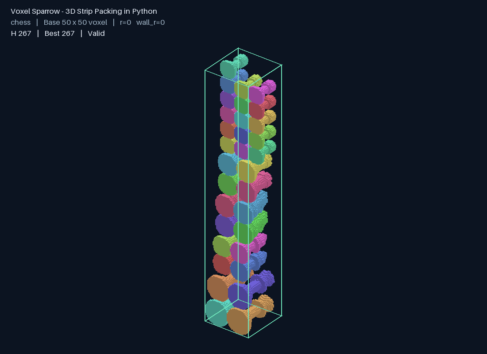

# Voxel Sparrow — 3D Strip Packing in Python - Demo Only

A Python framework for packing irregular voxel objects into a strip with fixed width and depth while minimizing height. Supports 90° rotations, adaptive search, object/wall clearance, interactive viewing, and compression GIFs.



## Setup

Python >= 3.10. Run from the repository root:

```sh
python -m pip install -e ".[visualization]"
```

Dependencies: NumPy and Pillow; see [lib.txt](lib.txt). The bundled Demo needs no external dataset.

## Features: inputs and outputs

| Feature | Input | Output |
| --- | --- | --- |
| Strip-packing solver | Instance JSON: container width/depth, objects, rotation and clearance settings | Solution JSON: optimized height, placements, orientations, density, feasibility, and search history |
| Compression GIF | Instance JSON plus search/playback budgets | Fixed-camera GIF, solution JSON, and replay trace JSON |
| Interactive UI | Demo or configured Chess/Engine source dataset; search parameters | Interactive 3D view and downloadable solution, scene, and GIF |
| Object orientation search | Per-item `rotate` flag | Selected proper 90° orientation, up to 24 possibilities |
| Object clearance | Top-level `r`, default **0** | Layout checked against a 26-neighbor-dilated pair NFV |
| Wall clearance | Top-level `wall_r`, default **0** | Layout checked against an eroded IFV for all six container faces |
| Adaptive compression | Time budget and Config search controls | Progress-guided step reduction; best feasible layout and recorded attempt outcomes |
| Batch benchmark export | NFV description/binvox tree and optional cross-section CSV | Per-instance GIFs/results/reports, gallery, summary CSV, and ZIP |
| Automated checks | Source code and optional original benchmark data | Test pass/fail report; external-data tests skip if data is absent |

## Input format

```json
{
  "width": 10,
  "depth": 10,
  "r": 0,
  "wall_r": 0,
  "items": [
    {
      "name": "L",
      "quantity": 4,
      "rotate": true,
      "voxels": [[0, 0, 0], [1, 0, 0], [0, 1, 0]]
    }
  ]
}
```

`width` and `depth` are positive integer X/Y dimensions; Z height is optimized. Each item supplies occupied integer XYZ `voxels`, or `file` pointing to a `.binvox` or 3D XYZ occupancy `.npy`. File paths are relative to the input JSON. Defaults: `quantity=1`, `rotate=true`, **`r=0`, `wall_r=0`**.

r/wall_r use computational voxels and Chebyshev neighborhoods: 1 leaves one empty layer. For coarse-grid inputs, one layer can represent multiple original voxels. r controls object-to-object clearance; wall_r controls clearance to walls, floor, and ceiling.

## Run a feature

**Solve a dataset → solution JSON**

```sh
python scripts/run_solver.py artifacts/all_datasets/chess/instance.json --seconds 300 --backend dense -o results/chess.json
```

Create the output parent directory first. Replace the input path to select another instance; use `examples/voxel_demo.json` for a small example.

**Solve and animate → GIF + solution + trace**

```sh
python scripts/make_gif.py artifacts/all_datasets/chess/instance.json --seconds 300 --gif-seconds 10 --output results/chess
```

Outputs: `packing.gif`, `solution.json`, `search_trace.json`. The GIF shows dataset, base dimensions, clearance settings, current/best height, and collision status. It defaults to all recorded moves; add `--accepted-only` for successful compression only. Long histories are sampled for playback, with the full selected trace retained.

**Interactive viewer → scene and downloadable results**

```sh
python scripts/run_ui.py --port 8765
```

Open [the local UI](http://127.0.0.1:8765). Demo works immediately. Original Chess/Engine presets need external data, configurable with `--data-root`. UI artifacts are saved under `artifacts/<job_id>/`.

**All benchmarks → gallery and reports**

```sh
python scripts/build_all_datasets.py --data-root ./data/NFV_open_dimension/data --seconds 20
python scripts/audit_all_datasets.py --data-root ./data/NFV_open_dimension/data
python scripts/finalize_gallery.py
```

Outputs are under `artifacts/all_datasets/`. Add `--resume` to reuse completed batch results. Existing cached instance inputs and GIFs work without the original source data; regeneration and original-geometry audit require it.

**Tests → validation report in the terminal**

```sh
python scripts/run_tests.py
```

## Reading the result

`container` is the final [width, depth, height]. `items` contains each position, orientation index, and already rotated `local_voxels`: add position to those cells to reconstruct the layout. Do not rotate again. `feasible` checks computational geometry against overlap, clearance, and boundary rules; nonzero losses in history describe unsuccessful attempts.

This is a heuristic voxel adaptation of Sparrow, not an exact paper reproduction or a guarantee of optimality. Wall-clock search limits can affect reproducibility. Solution JSON is not a checkpoint; warm-start/resume is not currently supported.

Details: [usage guide](docs/usage.md) · [architecture](docs/architecture.md) · [dependencies](docs/dependencies.md).
